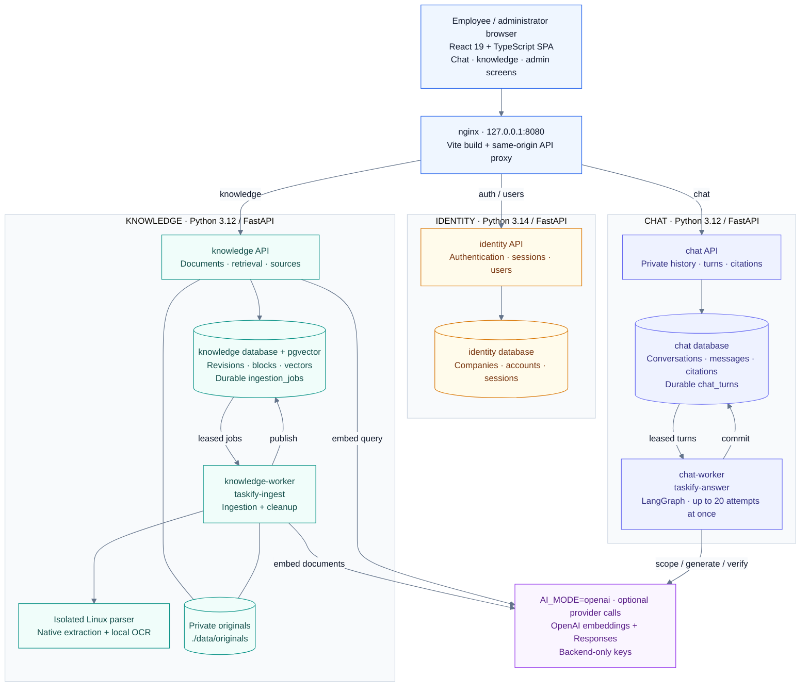
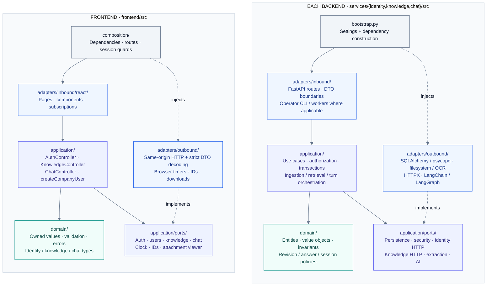
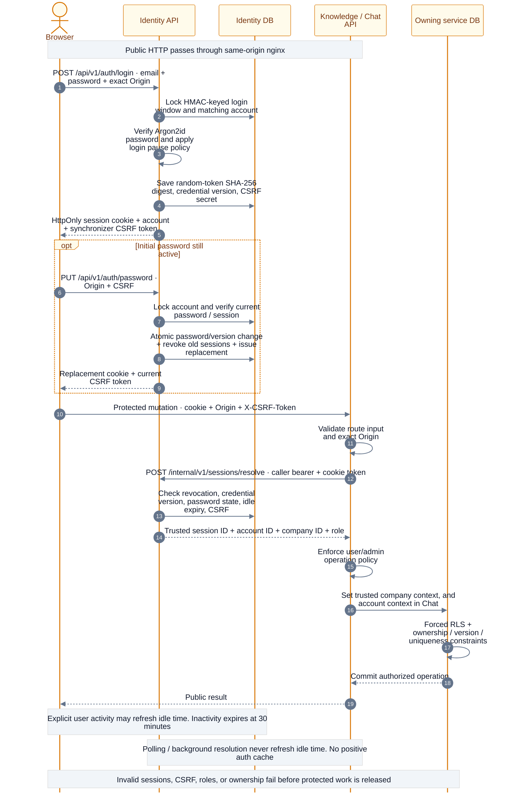
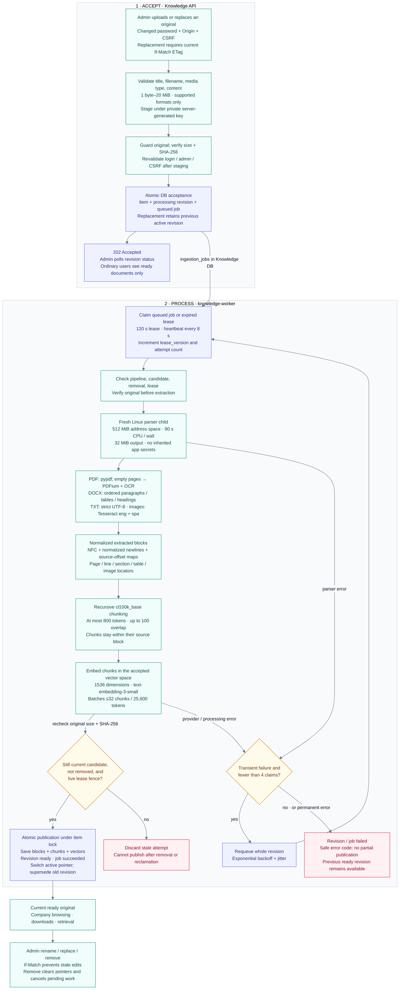
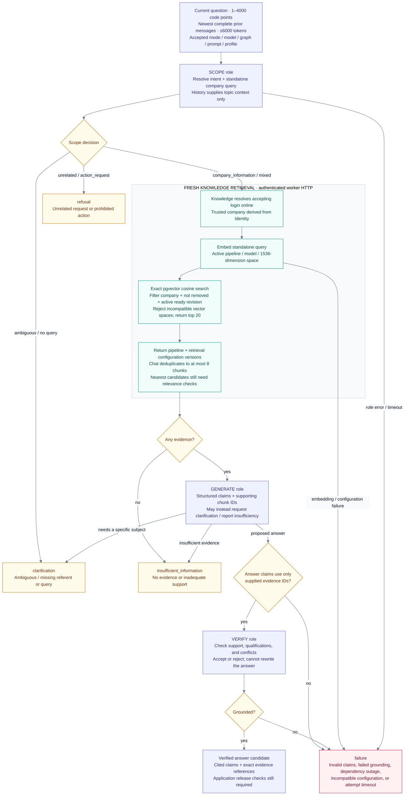
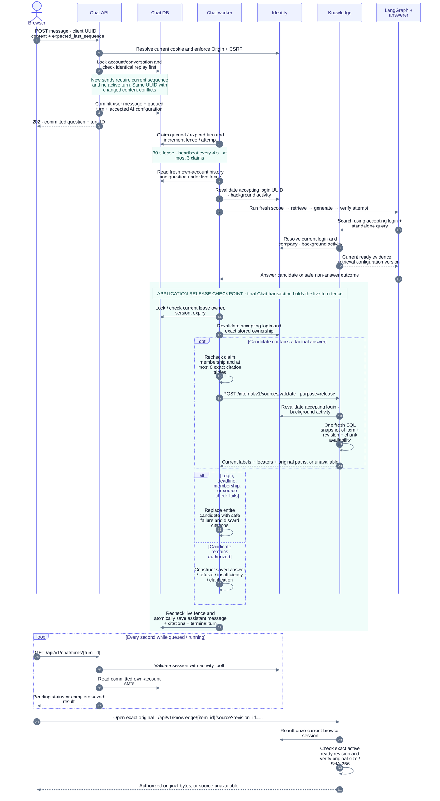
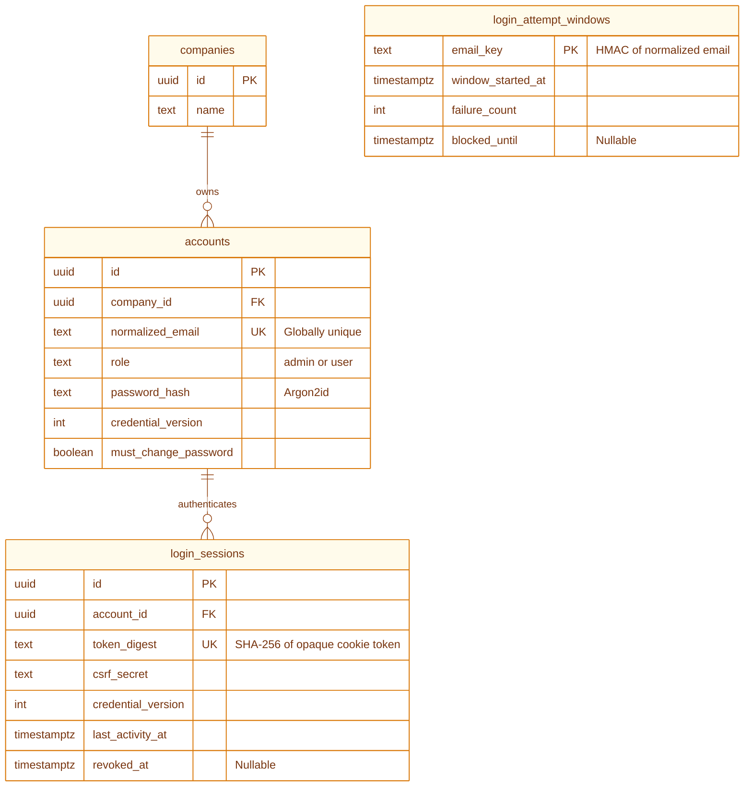
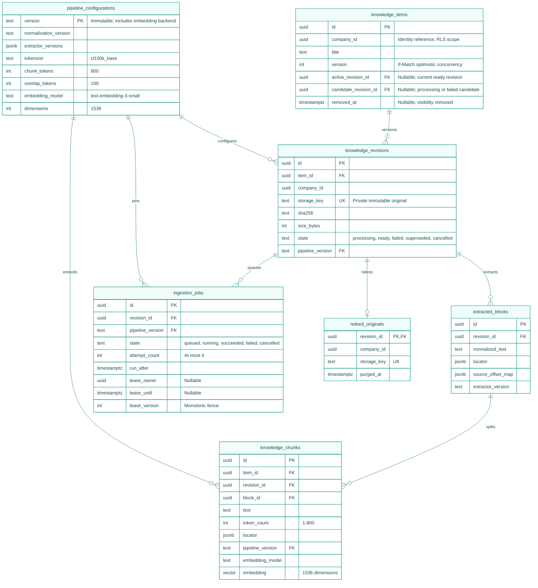
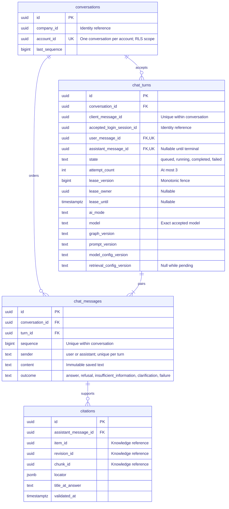
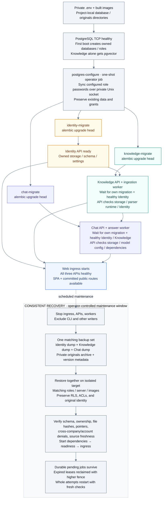

# Taskify — Company Knowledge Assistant - (Personal project)

Taskify lets employees ask questions about their company's documents and receive
answers with citations to the original sources. Administrators manage company
accounts and knowledge; each account has its own saved, private conversation.

The application is implemented and runs locally with Docker Compose. Local setup
uses deterministic AI stubs without paid provider calls. Independent review, live
OpenAI quality and performance measurements, and human onboarding studies remain
required for final acceptance. See the [validation record](specs/001-company-knowledge-qa/validation.md).

## What Demo Here

> [!NOTE]
> [Watch at youtube](https://www.youtube.com/watch?v=-8gFCtiwjQA)


[](https://www.youtube.com/watch?v=-8gFCtiwjQA)


## What it does

- Operators provision companies and their first administrators through a CLI.
- Administrators create user accounts and upload, rename, replace, or remove documents.
- Users browse ready documents, download authorized originals, and ask questions.
- Answers use current company knowledge and include authenticated source citations.
  Unsupported or ambiguous questions produce an explicit refusal, insufficient-information
  result, clarification, or processing failure.
- Conversations persist across reloads and logins. Accounts cannot read each other's
  chats, including administrators in the same company.

Supported originals are PDF (including scanned pages), DOCX, UTF-8 TXT, PNG, and
JPEG, from 1 byte through 20 MiB. English and Spanish OCR runs locally. Processing
has explicit resource limits, so an accepted upload can still fail processing.
A failed replacement preserves the previous ready document.

## Architecture

| Component | Stack | Owns |
| --- | --- | --- |
| [Identity](services/identity/README.md) | Python 3.14, FastAPI, PostgreSQL | Companies, accounts, passwords, sessions, operator provisioning |
| [Knowledge](services/knowledge/README.md) | Python 3.12, FastAPI, PostgreSQL/pgvector, local parsers/OCR | Original files, revisions, extraction, embeddings, ingestion jobs |
| [Chat](services/chat/README.md) | Python 3.12, FastAPI, PostgreSQL, LangGraph/LangChain | Private conversations, answer jobs, messages, citation references |
| [Web](frontend/README.md) | React, TypeScript, Vite, nginx, pnpm | Browser interface and same-origin API ingress |

Each backend owns a separate database with distinct runtime and migration roles.
Company and account access is enforced by application checks and PostgreSQL row-level
security. Services communicate through authenticated internal HTTP contracts rather
than reading another service's database. Only Knowledge mounts the private original-file
volume. Knowledge and Chat run separate workers for durable background jobs.

```text
.
├── frontend/          # Web application and browser tests
├── services/
│   ├── identity/      # Authentication and account management
│   ├── knowledge/     # Documents, ingestion, retrieval, and sources
│   └── chat/          # Saved conversations and answer generation
├── infra/             # Environment initialization, database bootstrap, recovery
├── tests/             # Composed contracts, fixtures, evaluation, and capacity
├── specs/             # Feature specification, design, contracts, and validation
└── compose.yaml       # Local application, workers, migrations, and test services
```

### Architecture map

These diagrams describe the implemented local Compose deployment and its code paths.
Amber identifies Identity, teal identifies Knowledge, and indigo identifies Chat;
rose marks rejected or failed work. Solid arrows show calls or processing steps;
dashed arrows show internal HTTP or supporting relationships, as labeled.

| View | What to follow |
| --- | --- |
| [Runtime topology](#runtime-topology) | Browser ingress, service boundaries, workers, databases, files, and providers |
| [Code and dependency direction](#code-and-dependency-direction) | Ports and adapters in the browser and each backend |
| [Identity and authorization](#identity-and-authorization) | Login, password rotation, CSRF, tenant context, and session expiry |
| [Document ingestion](#document-ingestion) | Accepted originals → isolated extraction → chunks → embeddings → publication |
| [Answer decision graph](#answer-decision-graph) | Scope → current evidence → structured claims → grounding verification |
| [Durable turns and source release](#durable-turns-and-source-release) | Idempotent acceptance, worker leases, final authorization, polling, and citations |
| [Service-owned data](#service-owned-data) | Principal entities, relationships, and persistence invariants |
| [Startup and recovery](#startup-and-recovery) | Migration gates, readiness, consistent backups, and abandoned work |

### Runtime topology

The three databases share one PostgreSQL 16 server, but each service has its own
credentials and schema ownership. Durable queues are tables in the owning database.
Internal calls use distinct API/worker bearer credentials; user authority is resolved
online through Identity. The browser reaches public routes through nginx on one origin.
This view shows deployment and storage; the sequence diagrams below expand internal calls.



`AI_MODE=stub` uses deterministic local answerers and embeddings without OpenAI calls.
Stub and OpenAI vectors have different pipeline-version suffixes. Tracing is separately
opt-in through LangSmith, with hidden inputs/outputs. PostgreSQL persists in
`./data/postgres`. nginx blocks `/internal`, `/health`, and `/metrics` and routes
`/api/v1/auth/*` and `/api/v1/users` to Identity, `/api/v1/knowledge` and its children
to Knowledge, and `/api/v1/chat` and its children to Chat.

All application data lives in the three databases plus the private originals;
Chat stores source references and never reads Knowledge's database or filesystem.

Implementation: [Compose](compose.yaml), [ingress](infra/nginx/default.conf), and the
[Identity](services/identity/src/taskify_identity/bootstrap.py),
[Knowledge](services/knowledge/src/taskify_knowledge/bootstrap.py), and
[Chat](services/chat/src/taskify_chat/bootstrap.py) composition roots.

### Code and dependency direction

Both browser and backend use ports and adapters. Arrows below represent **code
dependencies**, rather than network traffic. Application code defines the ports;
outbound adapters implement them. Composition roots supply concrete implementations.



Backend core imports only standard-library code and owned core modules; framework,
database, and provider libraries remain in adapters. Frontend core is independent of
React, Fetch, and browser storage. Import-linter contracts and
[frontend architecture rules](frontend/tooling/architecture.mjs) enforce these boundaries.
Account changes clear controllers and download URLs; generation counters and aborted
requests prevent late responses from repopulating another account's interface.

### Identity and authorization

Operators create companies and administrators through the CLI. Administrators can
create company users, whose role and company are assigned by the server. Every initial
password must be changed before protected Knowledge or Chat access is allowed.



Five failed logins for a normalized email within 15 minutes impose a 15-minute pause,
including unknown emails. Workers resolve stored login-session UUIDs with background-only
credentials. Runtime database roles are nonowners without `BYPASSRLS`; narrow definer
functions support session lookup and queue claims before ordinary tenant transactions.

Implementation: [authentication](services/identity/src/taskify_identity/application/authenticate.py),
[password changes](services/identity/src/taskify_identity/application/change_password.py),
and [internal caller scopes](services/identity/src/taskify_identity/adapters/inbound/http/internal_sessions.py).

### Document ingestion

Acceptance makes work durable before returning `202`; publication happens later.
Original bytes are immutable. Expensive extraction and embedding happen outside long
database transactions, and the worker must still own its lease when it publishes.



Decoded images/rendered pages are limited to 40 million pixels; DOCX archive entries
total at most 256 MiB uncompressed. Invalid, encrypted, unreadable, or oversized parser
inputs fail explicitly. A version/model-space mismatch also fails explicitly.

The worker runs conservative cleanup every minute: staging/orphans older than 24 hours
require file guards and a fresh reference check. Obsolete originals and derived data
require a locked visibility/job check before retirement. Revision metadata remains for
historical identity, and database outages preserve files for a later sweep.

Implementation: [acceptance](services/knowledge/src/taskify_knowledge/application/upload.py),
[processing](services/knowledge/src/taskify_knowledge/application/process_ingestion.py),
[parser](services/knowledge/src/taskify_knowledge/adapters/outbound/extraction_child.py),
[maintenance](services/knowledge/src/taskify_knowledge/application/maintain_knowledge.py),
and [cleanup](services/knowledge/src/taskify_knowledge/application/reconcile_storage.py).

### Answer decision graph

The Chat worker runs an acyclic LangGraph. Prior messages resolve the topic of a
follow-up; factual claims must come from freshly retrieved company evidence. Scope,
generation, and verification are separate structured model roles in OpenAI mode.



Mixed requests can answer the company-information part while explicitly declining
the prohibited part. Documents and history are untrusted input; they cannot authorize
actions or change ownership. All graph roles share a 60-second whole-attempt deadline,
a 12-step graph limit, and one transient provider retry. The graph has no tools,
back edges, checkpoints, stores, or result cache. SDK retries are disabled.

Implementation: [LangGraph workflow](services/chat/src/taskify_chat/adapters/outbound/langgraph_workflow.py),
[model roles](services/chat/src/taskify_chat/adapters/outbound/langchain_openai.py),
[prompts](services/chat/src/taskify_chat/adapters/outbound/prompts.py), and
[exact vector search](services/knowledge/src/taskify_knowledge/adapters/outbound/postgres/search.py).

### Durable turns and source release

One account owns one conversation across login sessions. A question and its queued
turn commit together; workers produce a candidate, while application code authorizes
the final saved response. The browser receives complete persisted results.



The source snapshot defines release consistency: replacement/removal **before** that
snapshot blocks the factual answer. A later change permits the already validated
answer to remain saved, but affects future retrieval, history citation hydration,
and source opens. Old citations never point to a replacement file.

An expired or reclaimed worker cannot commit its candidate or reuse a prior source
receipt. Recovery reruns the entire graph with fresh history/evidence and the turn's
accepted answer settings; provider calls may repeat. Unique terminal-message constraints
prevent duplicate saved answers. Reloading the page restores history and resumes polling
without creating another turn. No draft tokens stream to the browser.

Implementation: [message acceptance](services/chat/src/taskify_chat/application/submit_message.py),
[release transaction](services/chat/src/taskify_chat/application/process_turn.py),
[source snapshot](services/knowledge/src/taskify_knowledge/application/validate_sources.py),
and [browser controller](frontend/src/application/chat.ts).

### Service-owned data

The diagrams below show principal persisted fields, rather than every column or
composite constraint. Relationships stay inside each database. Knowledge and Chat
carry Identity UUID references, and Chat citations carry Knowledge UUID references;
these are validated through service contracts, with no cross-database foreign keys.
All identifiers are UUIDs unless a different key type is shown; timestamps are UTC.

<details>
<summary><strong>Identity database · companies, credentials, and revocable sessions</strong></summary>



Login windows include unknown emails and intentionally do not reference accounts.
The account's current credential version invalidates old sessions after password change.

</details>

<details>
<summary><strong>Knowledge database · versioned originals, provenance, vectors, and ingestion</strong></summary>



Tenant-owned rows carry `company_id`, including blocks, chunks, and jobs. Composite
foreign keys enforce exact item/revision/block ownership. Deferred guards require
active pointers to reference ready revisions; only one processing revision per item
and one job per revision/pipeline are allowed. Retiring bytes never relinks old sources.

</details>

<details>
<summary><strong>Chat database · private history, accepted turns, and exact citations</strong></summary>



Every Chat row carries both `company_id` and `account_id`; forced RLS isolates accounts
even inside the same company. Each turn has one user message and at most one assistant
message, with exactly one assistant required at termination. A partial unique index
allows only one queued/running turn per conversation. Accepted AI settings and ownership
are immutable; citation labels and locators remain tied to their exact original revision.

</details>

Schema sources: [Identity migration](services/identity/migrations/versions/0001_identity.py),
[Knowledge migrations](services/knowledge/migrations/versions), and
[Chat migrations](services/chat/migrations/versions).

### Startup and recovery

Compose gates normal startup on database configuration, owned migrations, and API
readiness. Migration credentials belong to one-shot operator jobs; runtime services
receive their own runtime credentials. Readiness probes use local configuration and
first-party dependencies without invoking OpenAI or LangSmith.



Backup consistency requires all three databases and their matching originals with
writes stopped throughout capture. Abandoned ingestion waits for its 120-second lease
boundary; abandoned turns wait for their 30-second boundary. Reclaimed attempts must
obtain fresh authorization/source checks and cannot reuse stale worker results.

Implementation and procedures: [database ownership](infra/postgres/README.md),
[local storage](infra/local-storage.md), [backup/restore](infra/backup-restore.md),
[tracing](infra/tracing.md), and the [restore exercise](tests/integration/test_restore_recovery.py).

## Run locally

For the containerized application, install Docker with Compose and Python 3 to
initialize configuration. Host development additionally uses uv, Python 3.14 for
Identity, Python 3.12 for Knowledge/Chat, Node.js 22.12+, and the pnpm version pinned
in [frontend/package.json](frontend/package.json).

If you previously ran this project with named data volumes, choose either a
[fresh start](infra/local-storage.md#start-empty-with-existing-named-volumes) or
[migration](infra/local-storage.md#move-existing-named-volume-data) before starting
services with the new mounts.

For a new installation, run these commands from this project directory:

```sh
python3 infra/init-env.py
docker compose build
mkdir -p data/postgres data/originals
docker compose run --rm --no-deps --user root --entrypoint chown knowledge 10001:10001 /data/originals
docker compose up -d
docker compose ps
```

The initializer creates a private, ignored `.env` with independent random development
secrets. It refuses to overwrite an existing file; skip that command if your environment
is already initialized. Subsequent starts need only `docker compose build` and
`docker compose up -d` (or combine them with `docker compose up -d --build`).

Compose waits for PostgreSQL, synchronizes the local database role passwords with
the configuration, and runs all three migrations before starting their APIs and
workers. The web app waits for API readiness. The `postgres-configure` and
`*-migrate` containers finish with `Exited (0)`; this is expected. Runtime APIs and
workers receive only their own runtime database credentials. Existing data directories
are preserved. Production password rotation requires coordinating database clients
and operator access separately.

Open **[http://localhost:8080](http://localhost:8080)**. PostgreSQL is available to host
development tools at `127.0.0.1:55432`. The web application and database bind to loopback;
production deployment requires HTTPS, secure cookies, and encrypted service traffic.

### Fix database password authentication failures

If a migration reports `password authentication failed`, an existing PostgreSQL
volume may still contain passwords from an earlier `.env`. PostgreSQL runs
`bootstrap.sql` only when creating a new database volume; changing `.env` or
rebuilding images does not update existing role passwords.

The local `postgres-configure` startup job handles this automatically using a
private Unix socket shared only with PostgreSQL. With the current Compose file,
build and start the application:

```sh
docker compose build
docker compose up -d
```

This preserves existing databases and documents. Keep the `data/` directory;
`docker compose down -v` does not delete these bind-mounted files. To inspect startup
failures, run
`docker compose logs postgres-configure identity-migrate knowledge-migrate chat-migrate`.

### Create the first administrator

```sh
docker compose run --rm identity taskify-admin create \
  --company-name "Your company" \
  --display-name "Your name" \
  --email admin@example.com
```

The CLI prompts for a hidden, confirmed initial password. Log in and change that
password before using the application. To create another administrator for an existing
company, replace `--company-name` with `--company-id UUID`.

Administrators create user accounts at `/admin/users` and manage documents at
`/admin/knowledge`. Users browse ready originals at `/knowledge` and ask questions
at `/chat`. New users must also change their initial password. Share initial credentials
through your company's trusted channel; there is no public signup.

### Everyday commands

```sh
docker compose ps
docker compose logs --tail=100 identity knowledge knowledge-worker chat chat-worker web
docker compose stop
```

After changing application code, run `docker compose build` and `docker compose up -d`.
PostgreSQL data and originals persist in this project's `data/postgres/` and
`data/originals/` directories through bind mounts. Both are excluded from Git and Docker
build contexts. See the [local storage guide](infra/local-storage.md) to move existing
named-volume data before starting with these mounts. The shared PostgreSQL socket is
temporary communication state and remains in a Docker-managed volume; images, build
cache, and container logs also remain managed by Docker. Follow the
[backup and restore guide](infra/backup-restore.md) for a consistent snapshot of all
three databases and original files.

## AI configuration

[.env.example](.env.example) documents the configuration variables. Keep provider keys
and service credentials in backend configuration, outside version control and browser bundles.

| Setting | Purpose |
| --- | --- |
| `AI_MODE=stub` | Default deterministic development mode; makes no provider calls |
| `AI_MODE=openai` | Enables real OpenAI embeddings and answers; requires explicit configuration |
| `OPENAI_API_KEY` | Backend-only provider key for OpenAI mode |
| `OPEN_AI_MODEL` | Required exact chat model in OpenAI mode; no default or fallback |
| `OPENAI_EMBEDDING_MODEL` | Independent Knowledge embedding model; configured as `text-embedding-3-small` |
| `EMBEDDING_DIMENSIONS` | Fixed at 1536 in the current pipeline |
| `PIPELINE_VERSION` | Version of the immutable ingestion and embedding pipeline |
| `PUBLIC_ORIGIN` | Exact browser origin used for mutation validation; locally `http://localhost:8080` |

Stub and OpenAI embeddings occupy distinct versioned vector spaces. Switching embedding
mode, model, or pipeline requires a new version and explicit reindexing or fresh fixtures.
Changing only the chat model does not require re-embedding. See the
[quickstart](specs/001-company-knowledge-qa/quickstart.md) before enabling paid processing.

LangSmith tracing is optional and disabled by default. Chat and Knowledge support
opt-in traces with hidden inputs/outputs; Identity has no tracing dependency.
See [LangSmith tracing setup and troubleshooting](infra/tracing.md) for the separate
LangSmith key, project, endpoint, workspace, expected spans, and verification steps.

If an upload ends with `processing_unavailable`, check
`docker compose logs --tail=100 knowledge-worker`. An
`embedding_unavailable error_type=AuthenticationError status=401` means OpenAI rejected
the worker's key. Correct `OPENAI_API_KEY` in the private `.env`, then run
`docker compose up -d --wait` to recreate services with the updated environment;
`docker compose restart` does not reload `.env`. Upload again after correcting the key;
failed jobs have exhausted their automatic retries. For PostgreSQL's
`remaining connection slots are reserved` error, see the
[connection budget](infra/postgres/README.md).

## Development and checks

Install locked backend dependencies with each service's Python version:

```sh
uv sync --project services/identity --python 3.14 --locked
uv sync --project services/knowledge --python 3.12 --locked
uv sync --project services/chat --python 3.12 --locked
```

With local PostgreSQL initialized, run the owned backend suites:

```sh
(cd services/identity && TASKIFY_RUN_DB_TESTS=1 .venv/bin/pytest tests -q)
docker compose run --rm --build knowledge-test
(cd services/chat && TASKIFY_RUN_DB_TESTS=1 .venv/bin/pytest tests -q)
```

Knowledge's strict parser isolation requires Linux. Use the Docker test service;
macOS parser skips do not establish parser acceptance. Database fixtures target only
the dedicated service test databases.

Run static checks from each service directory so its configuration is applied:

```sh
uv run ruff check .
uv run ruff format --check .
uv run mypy src
uv run lint-imports
```

Use pnpm for frontend dependencies and checks:

```sh
pnpm --dir frontend install --frozen-lockfile
pnpm --dir frontend typecheck
pnpm --dir frontend lint
pnpm --dir frontend test --run
pnpm --dir frontend build
```

The [frontend guide](frontend/README.md) covers the development server and browser-test
credentials. The [quickstart](specs/001-company-knowledge-qa/quickstart.md) covers composed
contract tests, fixture provisioning, and isolated restore checks.

Recorded engineering validation includes 136 backend tests, 26 frontend tests, ten
real-stack browser checks, composed API contracts, and backup restoration. These results
use deterministic provider substitutes where applicable. Live-provider evaluation,
independent grading, capacity measurements, and onboarding with at least ten first-time
administrators and ten users remain open; see the
[validation record](specs/001-company-knowledge-qa/validation.md) for evidence and limitations.

## Documentation

| Guide | Contents |
| --- | --- |
| [Quickstart](specs/001-company-knowledge-qa/quickstart.md) | Full setup, checks, fixtures, and acceptance workflow |
| [Feature specification](specs/001-company-knowledge-qa/spec.md) | Stories, requirements, and success criteria |
| [Implementation plan](specs/001-company-knowledge-qa/plan.md) | Design, boundaries, and technical decisions |
| [Task list](specs/001-company-knowledge-qa/tasks.md) | Implementation progress and remaining acceptance work |
| [Data model](specs/001-company-knowledge-qa/data-model.md) | Service-owned entities and invariants |
| [Public HTTP contract](specs/001-company-knowledge-qa/contracts/http.md) / [OpenAPI](specs/001-company-knowledge-qa/contracts/openapi.json) | Public operations, schemas, and errors |
| [Internal contracts](specs/001-company-knowledge-qa/contracts/internal.md) | Authenticated service-to-service interfaces |
| [Frontend contract](specs/001-company-knowledge-qa/contracts/frontend.md) | Browser flows and behavior |
| [Operator CLI](specs/001-company-knowledge-qa/contracts/cli.md) | Company and administrator provisioning |
| [Backup and restore](infra/backup-restore.md) | Consistent database and original-file recovery |
| [Quality evaluation](tests/evaluation/README.md) | Reference review and opt-in live-provider grading |
| [Capacity and onboarding](tests/load/README.md) | Load measurements and human-study requirements |
| [Validation record](specs/001-company-knowledge-qa/validation.md) | Executed checks, measured results, and outstanding gates |
| [Project constitution](.specify/memory/constitution.md) | Engineering principles and acceptance requirements |
